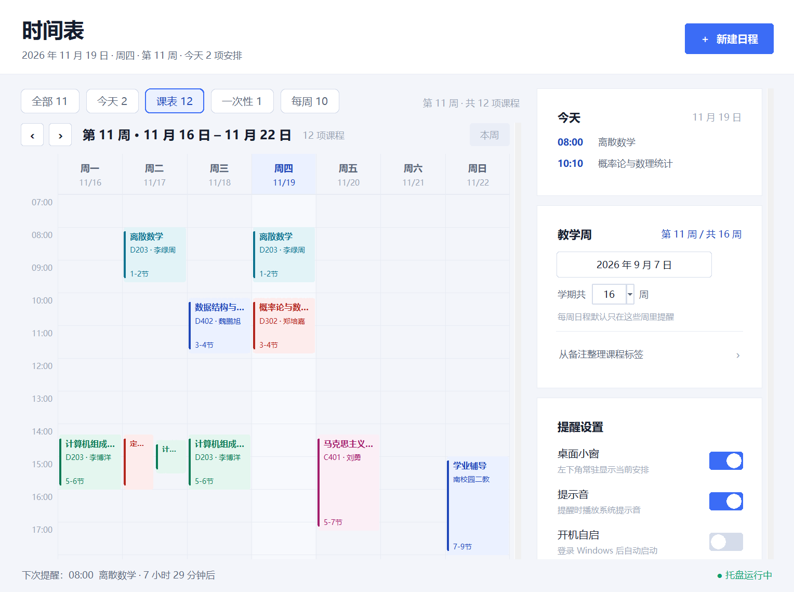
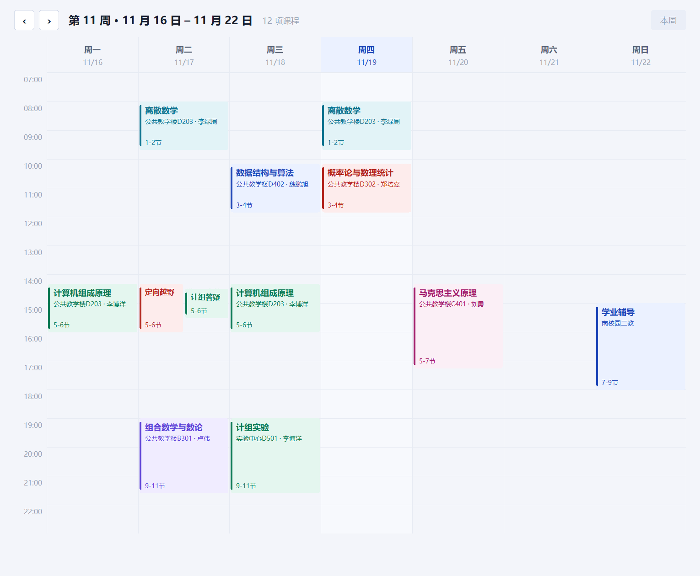

# 时间表

一个常驻 Windows 右下角托盘的小工具：把「某天某个时间段要做什么」「每周几的固定安排」和「这学期上什么课」记下来，按周看课表，到点弹出提醒卡片。





> 截图里的课程、老师、教室和日程都是虚构的示例数据，方便演示，不涉及任何真实课表。

- 双击 `timetable.pyw` 启动，没有黑框，直接缩在右下角托盘里
- **左下角站着一只会眨眼的鲸鱼娘**（桌宠）：逐像素透明地蹲在桌面上，鼠标停上去会浮出「现在／接下来」信息卡，滚轮能调大小，单击打开主窗口，按住可以拖到任意位置
- 支持**一次性日程**（指定日期）和**每周重复**（可多选星期，例如每周一、三、五）
- **周课表视图**：只画勾了「计入课表」的日程，周一~周日 × 时间轴，按科目自动配色；点色块编辑，点空白格子加一门课
- **教学周与单双周**：设置学期第 1 周周一和总周数，课程只在这些周提醒；单条课程还能设起止周、单周/双周
- **课程标签**：科目、老师、教室、课次分开填，列表、提醒卡片和课表里显示成小标签；旧数据可从备注一键提取
- **两种提醒方式**：时间段（09:00–10:00，到点开始提醒）或**只提醒一次的时间点**（15:00 吃药），后者点「已完成」就打勾记录
- 每条日程都能写**备注**（地点、要带的东西、注意事项等），列表和提醒卡片里都会显示
- **同一个时段可以放多件事**：开始时间相同的安排到点会合并成一张提醒卡片，逐条列出
- 到点后从屏幕右下角滑出一张提醒卡片，可「知道了」或「稍后 5/15 分钟」
- 默认开启**开机自启**，登录 Windows 就自动在托盘待命
- 提示音、暂停提醒、托盘右键菜单、今日安排一览
- 数据存在本地 `data/schedule.json`，不联网、不上传

## 列表怎么排列

顶部五个筛选各自有不同的排列方式：

| 筛选 | 排列方式 |
| --- | --- |
| **全部** | 平铺所有日程，一条一行，不分组 |
| **今天** | 平铺今天会发生的事项（一次性 + 今天该做的每周事项） |
| **课表** | 只显示勾了「计入课表」的日程，按周画成网格：周一~周日 × 时间轴 |
| **一次性** | 按日期分组：`2026 年 11 月 18 日 周三`，下面按时间编号 `1.` `2.` `3.` |
| **每周** | 按周一~周日分组，一条每周日程会在它重复的每个星期下各出现一次 |


## 课表视图

顶部「课表」只画勾了**「计入课表」**的日程。每周安排默认勾上；一次性安排（跑腿、作业、DDL）默认不勾，留在「今天」「全部」里，提醒照常。考试这种想进课表的一次性安排，编辑时把开关打开即可。



- 纵轴是时间（按最早/最晚的课自动取范围，通常在 07:00–23:00 之间），横轴是周一~周日
- 同一门课（按科目，没有科目就按标题）固定一种颜色，同一门课的不同时段颜色一致
- 色块上尽量显示：课程名、`教室 · 老师`、课次；太窄时用短教室名（`公共教学楼D203` → `D203`）
- 时间重叠的课程会并排显示
- 课表只画勾了「计入课表」的日程，不画跑腿/作业/时间点提醒——这些在「今天」「全部」里看
- 今天那一列有淡蓝底，红线标出当前时间
- `‹` `›` 翻周，标题显示「第 11 周」；「本周」回到当前周
- 点色块 → 编辑这门课；点空白格子 → 新建每周课程（默认计入课表；想建一次性可在对话框里切换类型）
- 已暂停的日程不显示；鼠标停在色块上会浮出完整标题、时间、教室、老师和备注

## 教学周与课程标签

右侧「教学周」卡片：

- 点「选择第 1 周的周一」选一个日期（选哪天都行，会自动归到那一周的周一）
- 「学期共 N 周」设置总周数（默认 18）
- 设好之后，所有每周日程默认只在第 1–N 周内提醒，放假后不会继续响
- 编辑对话框里还能给单条日程设「第几周到第几周」以及**单周/双周**；关掉「按教学周」就恢复成全年重复

「课程信息」四个标签都可以单独填，也可以留空

填了之后，列表卡片、提醒卡片和课表色块都会显示成标签；科目还决定课表的配色（和标题不同时会额外显示一个彩色标签）。旧日程如果只把教室和老师写在备注里（例如「公共教学楼D203 李绿周」），可以在右侧点「从备注整理课程标签」批量提取：只填空字段、不覆盖已填内容，执行前会先确认一次。

## 点击与操作

- 点卡片任意位置 → 编辑这条日程（每周事项改的是整个系列）
- 右侧开关 → 暂停/启用
- 编辑对话框「类型」右边的「计入课表」开关：决定它是否出现在课表；每周默认开、一次性默认关
- 「完成 / 撤销」→ 只对时间点提醒显示，按「哪一天的那一次」记录
- 「删除」→ 每周事项会提示删除整个系列
- 课表视图里点色块 → 编辑；点空白格子 → 新建；`‹` `›` 翻周

## 左下角小窗（鲸鱼娘桌宠）

启动后，一只会眨眼的鲸鱼娘站在屏幕左下角，平时只画她自己，不在桌面上写文字：

- **逐像素透明**：她之外的地方完全透明，看不出窗口边界；点在空白处等于点在桌面上
- **自己会眨眼**，偶尔连眨两下；点她一下也会眨一下
- **暂停提醒时她会闭眼打盹**，恢复提醒后接着眨眼
- **鼠标停在她身上**会浮出一张小卡片：现在几点、当前做什么（还剩多久、进度条）、接下来是什么；移开就收起
- **滚轮上下滚**可以放大 / 缩小她（60%–180%），大小会记住；右键菜单里也能调、一键恢复 100%
- **单击**打开主窗口；**按住拖动**可以放到任意位置（会记住坐标，多显示器也能拖过去）
- **右键**菜单：打开时间表 / 新建日程 / 暂停提醒 / 总在最前 / 放大 / 缩小 / 恢复默认大小 / 隐藏小窗 / 退出
- 不想悬停的时候也可以点开主窗口看今天的安排；托盘图标的提示文字里也有下一项
- 不想看的时候：主窗口右侧「桌面小窗」开关关掉，或托盘菜单里取消勾选

素材来自 DeepSeek 社区的「鲸鱼娘 / 大肥鱼」形象，来源、许可和本项目的改动见
[assets/pet/NOTICE.md](assets/pet/NOTICE.md)。


## 第一次使用

1. 双击 `D:\timetable\timetable.pyw`（`.pyw` 用 pythonw 打开，不会闪黑框）。
2. 主窗口右上角点「＋ 新建日程」：
   - 选「一次性」→ 点日期选具体某天（右侧「今天/明天/后天」可快速选）
   - 选「每周重复」→ 点一到日选择重复的星期，可多选
   - 选**时间段**（开始–结束）或**只提醒一次**（只填一个时间点）
   - 填提前多少分钟提醒、要做什么、备注；课程可以顺手填科目/老师/教室/课次
   - 同一个时间段想安排几件事，就重复添加几条，时间填成一样
3. 第一次用先在右侧「教学周」设置第 1 周的周一和学期总周数，每周课就只在这些周提醒。
4. 保存后关掉窗口，程序继续留在右下角托盘里；切到「课表」筛选就能按周看。

托盘图标：**左键单击或双击**打开主窗口；**右键**弹出菜单（打开时间表、新建日程、今天的安排、暂停提醒、开机自启开关、打开数据文件夹、退出）。

> Windows 11 默认会把新的托盘图标收进「隐藏的图标」小箭头里。想让它一直显示：任务栏设置 → 其他系统托盘图标 → 把「时间表」打开。

## 提醒是怎么触发的

- 每条日程只在每次「发生」时提醒一次，重启程序不会重复提醒。
- 设了教学周之后，每周日程只在第 1–N 周内提醒；单双周课程只在对应周提醒。
- 默认在开始时间提醒；可以设置「提前 5/10/15/30 分钟、提前 1/2 小时」。
- **开始时间相同的多条日程会合并成一张提醒卡片**（最多列出 4 条，其余提示到主窗口查看），每条都会带上自己的备注。
- **时间点提醒**没有结束时间，到点弹一张卡片，主按钮是「已完成」：点一下就把这次标记为完成，之后不会再提醒它。
- 完成状态按「哪一次」记录：一次性日程完成就是永久完成；每周重复的日程只完成当天那一次，下周照常提醒。
- 也可以不动提醒卡片，直接在列表里点「完成」/「撤销」；已完成的项目标题会加删除线，侧栏「今天」列表里带 ✓。
- 如果电脑刚开机或刚从睡眠醒来，开始时间已过但还在宽限期内（默认 30 分钟，见下文「设置项」），仍会提醒你，并标注「已开始 N 分钟」；超过宽限期就不再打扰。
- 结束时间早于开始时间表示**跨夜**（例如 22:00 – 01:30）。
- 「稍后提醒」只影响这一次，不会改动日程本身；合并提醒里的多条会一起稍后。

## 设置项

主窗口右侧「提醒设置」里可以：

| 开关 | 作用 |
| --- | --- |
| 桌面小窗 | 左下角那只鲸鱼娘，关掉后只保留托盘图标 |
| 提示音 | 提醒卡片出现时播放系统提示音 |
| 开机自启 | 写入/删除当前用户的开机启动项（启动文件夹快捷方式 + 注册表） |
| 测试提醒 | 立刻弹一张示例卡片，用来确认提醒样式和提示音 |
| 创建桌面快捷方式 | 在桌面生成「时间表.lnk」 |
| 打开数据文件夹 | 打开 `data/`，可以直接备份 `schedule.json` |
| 退出时间表 | 完全退出程序（关窗口只是缩到托盘） |

宽限期（默认 30 分钟）在 `data/schedule.json` 的 `settings.grace_minutes` 里，想改可以退出程序后手动改这个数字。小窗大小存在同一个文件的 `settings.pet_scale`（0.6–1.8，`1.0` 是默认大小），滚轮调整时会自动写回去。

## 数据与备份

- 日程和设置：`data\schedule.json`（UTF-8，可读文本）
- 运行日志：`data\app.log`（出问题时先看这里）
- 想换电脑或备份：把整个 `D:\timetable` 文件夹拷走即可；程序装在别的盘也可以，开机自启路径会在启动时自动修正。
- 旧版数据可以直接用：新增的「教学周」「课程标签」字段缺失时按默认值处理，不会丢日程。

## 开机自启说明

- **不需要管理员权限**，只影响当前用户。程序会同时做两件事，任意一个成功即可开机启动：
  1. 在「启动」文件夹放一个快捷方式：`%APPDATA%\Microsoft\Windows\Start Menu\Programs\Startup\时间表.lnk`（任务管理器的「启动应用」里能看到）；
  2. 写注册表启动项：`HKCU\Software\Microsoft\Windows\CurrentVersion\Run` 下的 `TimetableReminder`。
- 开机启动时不弹主窗口，只在右下角托盘待命并显示一条提示。
- 在界面上关掉「开机自启」后，程序会把上面两处都清掉，也不会再自动打开它；重新打开即可恢复。
- 想彻底移除：关掉开关，或手动删除那个快捷方式 / 注册表值，或直接删掉整个文件夹。

## 常见问题

**右下角没有图标？**
Windows 11 会把新图标收进溢出区，点任务栏的「^」看看。确认程序在运行：任务管理器里应有 `pythonw.exe`；也可以看 `data\app.log` 是否有「托盘图标已添加」。

**到点没有提醒？**
- 托盘菜单里是否点了「暂停提醒」？
- 日程是否被关掉了开关（列表右侧的开关，灰色表示已暂停）？
- 是否超过了宽限期？例如电脑睡到 15:00 才醒，而日程是 09:00–10:00，就不会再提醒。
- 看 `data\app.log` 里有没有「弹出提醒」的记录。

**时间对不上？**
程序用的是系统本地时间，请确认 Windows 时区设置正确。

**鲸鱼娘点不到？**
她身上完全透明的像素不接收鼠标，点在那儿等于点在桌面上；对准脸或裙子点就行。如果整个都不见了，看主窗口右侧「桌面小窗」开关和托盘菜单里的勾选。

**想重新来一遍？**
退出程序，删除 `data\schedule.json`（或把 `entries` 清空），再启动。

## 素材与署名

桌宠形象来自 [YunYueSama/codex-deepseek-pet](https://github.com/YunYueSama/codex-deepseek-pet)，
按「大肥鱼项目署名许可 1.0」使用：可以修改和再分发，但要保留作者和仓库地址，并说明改了什么。

`assets/pet/` 里的两帧由上游 `assets/whale/idle-front.png` 裁切对齐、加了地面阴影生成，
用 `python tools\build_pet_assets.py` 可以重新生成；具体来源、改动和许可全文见
[assets/pet/NOTICE.md](assets/pet/NOTICE.md)。

「鲸鱼娘 / 大肥鱼」是 DeepSeek 社区的拟人二创形象，本项目只是个人自用的时间表工具，
和 DeepSeek 官方无关。

## 文件结构

```
timetable.pyw          入口（双击运行）
app/
  application.py       控制器：托盘、定时检查、提醒弹窗、设置
  model.py             日程模型与重复规则
  scheduler.py         什么时候该提醒
  store.py             本地 JSON 读写
  ui_main.py           主窗口
  ui_week_grid.py      周课表网格（色块、翻周、悬停提示）
  ui_entry_dialog.py   新建/编辑对话框
  ui_reminder.py       右下角提醒卡片
  ui_desktop_pet.py    左下角鲸鱼娘小窗（缩放、悬停、拖动）
  ui_pet_info.py       悬停浮出的「现在／接下来」信息卡
  ui_pet_menu.py       小窗右键菜单（自绘圆角卡片）
  win32_pet.py         桌宠的原生分层窗口（逐像素透明、眨眼、拖动）
  widgets.py           自绘控件（按钮、开关、滚动区、日历）
  win32_tray.py        托盘图标（ctypes 调 Windows API，无第三方依赖）
  autostart.py         开机自启
  shortcuts.py         桌面快捷方式
  icons.py             运行时生成图标
  theme.py             配色与字体
tests/test_model.py    核心逻辑单元测试
tools/                 开发自检脚本（截图、托盘探针、桌宠探针、素材生成等）
data/                  日程、日志（自动生成）
assets/                app.ico、app-256.png
assets/pet/            鲸鱼娘两帧（睁眼/闭眼）与素材许可
```

## 开发与自检

```powershell
# 单元测试
python -m unittest discover -s tests -v

# 托盘是否注册成功（正常权限下应输出 tray.added=True）
python tools\tray_probe.py

# 单独预览界面并截图
python tools\ui_preview.py dialog
python tools\ui_preview.py dialog-weekly
python tools\ui_preview.py popup
python tools\ui_preview.py calendar
python tools\ui_preview.py main        # 主窗口（课表视图）
python tools\ui_preview.py main-list   # 主窗口（列表视图）
python tools\ui_preview.py grid        # 单独的周课表
python tools\ui_preview.py pet         # 鲸鱼娘桌宠（合成预览图）
python tools\ui_preview.py pet-hover   # 悬停信息卡的预览图

# 桌宠自检（原生分层窗口 / 鼠标事件 / 右键菜单 / 悬停 / 缩放）
python tools\probe_pet_window.py
python tools\probe_pet_events.py
python tools\probe_pet_menu.py
python tools\probe_pet_hover.py
python tools\probe_pet_app.py      # 接到假 app 上跑一遍点击、菜单、位置保存

# 重新生成桌宠素材（会从 GitHub 下载上游源图）
python tools\build_pet_assets.py

# 滚轮滚动自检（打印每格滚动的像素数）
python tools\bench_scroll.py

# 灌入演示数据（会覆盖 data/schedule.json，注意先备份）
python tools\seed_demo.py
```

需要 Python 3.10+，只用到标准库 + Pillow（生成图标、缩放桌宠帧）。托盘是直接用 ctypes 调 `Shell_NotifyIcon`，桌宠窗口也是 ctypes 调 `UpdateLayeredWindow`，不需要 pywin32。
